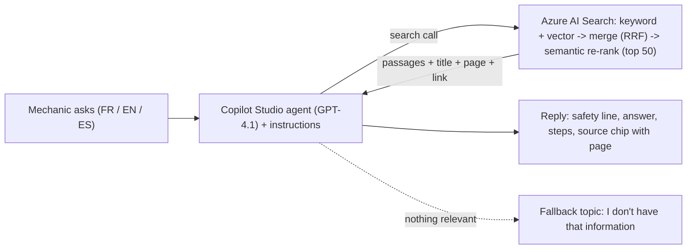

# BOULON: cloud AI architecture brief for Greg Riley

Role: senior AI cloud engineer review (Azure AI Search / RAG). Reader: Greg, who presents tonight. Henri Eckern and Pierre Zivec are informed, not gatekeepers. This brief gives no future dates or deadlines: every plan is an ordered list of steps. (File names in section 9 carry the dates of the evidence only.)

**How to read the labels (used on every figure).** **[M]** Measured (counted in project files). **[V]** Verified (Microsoft Learn or a paper, URL in section 9). **[E]** Estimate (my arithmetic from [M] or [V] inputs). **[U]** Unknown (not found or not checked). **[I]** Inferred (my reasoning, not proven).

**Terms for this page.** *RAG* (retrieval-augmented generation) = the AI first looks up passages in the manuals, then answers only from them. *Chunk* = one searchable piece of a manual. *Index* = the searchable copy of the manuals inside Azure AI Search. *Retrieval* = the look-up step; *generation* = the step where GPT-4.1 writes the reply. *Golden set* = questions with known answers used to score the system. *Abstain* = say "I don't have that information" instead of guessing. *Tier* has two meanings here: **Azure tier** (Free, Basic, S1 = size and price of the search service) and **knowledge tier** (tier 1 = manuals, authoritative; tier 2 = MIR work orders, advisory). Section 8 defines every other term.

---

## 1. Bottom line, and what to say tonight

**Bottom line.**
1. The design (one Copilot Studio agent, one Azure AI Search index, keyword + meaning search, Microsoft re-ranker) is the right one for 15 users and about 21 questions a day, and nothing in the advanced RAG catalogue is worth adding yet.
2. The weak point is not search, it is **numbers and tables**: the search step finds the right passage 41 of 41 times in the pilot [M], but the finished agent still gave a wrong torque once (12.7 instead of 15) and invented a value for a heater model not in the manual [M].
3. The biggest free wins are rules and tests, not new technology: stricter instructions, a Spanish and cross-language test set, a "page cited is correct" check, and an offline "every number appears in a retrieved passage" check.
4. Three things must be settled **before the first paid indexing run** because changing them later means paying to re-read the pages: compress the vectors (otherwise the full library may need a second search partition [E]; the trial measures it), put manual name and headings into what gets embedded, and choose the PDF reader on a one-file trial.
5. A locally hosted BOULON comes in three sizes (local PDF reading only, local search behind Copilot Studio, or everything local); the files show monthly hosting about equal and local reading possibly much cheaper [E], but quality, citations and who runs it are Unknown, so ask Sebastien what he is trying to achieve and test on the same 41 questions.

### What to say tonight (8 talking points, say them aloud)

| # | Say this | Number or fact | Label |
|---|---|---|---|
| 1 | "The pilot reads 23 manuals, cut into 2,250 searchable pieces." | 23 PDFs, 2,250 chunks | [M] |
| 2 | "On 41 test questions, the search step finds the right passage in the top 5 every time when Microsoft's re-ranker is on; with plain keyword search it finds 30 and with keyword plus meaning it finds 35." | 41/41 vs 35/41 vs 30/41 (search step only, not the final answer) | [M] |
| 3 | "The finished agent is good but not yet safe enough: after the latest instruction change about 39 of 41 questions behaved correctly and 22 of 36 stress cases passed, with 4 serious failures left." | about 39/41; 22 pass, 7 safe, 7 fail of 36; 4 high-severity | [M] (hand-scored, continuity log) |
| 4 | "Our biggest known risk is torque tables. The pilot flattens them into run-together text, and the agent has given a wrong torque more than once, for example 12.7 Nm instead of 15 Nm. The fix is built into the paid rebuild and is not proven yet." | M6 class 12.9 = 15 Nm, Vicinity p.22; wrong values in F17, F34 and again after the last change | [M] |
| 5 | "The whole Quebec library is 2,785 unique manuals, about 131,756 pages. The free search service holds 50 MB, so it cannot hold more than the pilot." | 131,756 pages, 6.53 GB; Free = 50 MB | [M] / [V] |
| 6 | "Paid search costs about CAD 104 to 112 a month. Reading all pages once costs roughly CAD 933 to 3,652 depending on the reader. The project brief's CAD 5,510.50 has no search line." | Basic 104.46 to 112.42 per month; one-time ranges | price [V], totals [E]; brief [V] |
| 7 | "Use will be small: 7 questions per site per day is about 21 a day, about 630 a month. That is why fancy retrieval tricks are not worth their complexity." | 3 × 7 × 30 = 630 | [E] from brief [V] |
| 8 | "Local hosting is a fair idea and comes in three sizes. Monthly hosting would be about the same; reading the PDFs locally could be much cheaper. What decides it is answer quality on our 41 questions, whether citations still work, and who would run it." | Search hosting about CAD 104/month on Azure vs about CAD 103 to 202 self-hosted; PDF reading CAD 933 to 1,826 on Azure vs under CAD 100 on a rented GPU | [E] |

**Do not say tonight:** "41 of 41 correct" without "search step only"; "one-time cost CAD 650" (that assumed about 20,000 pages, the library is 131,756 [M]); "manuals are cut off at 262K characters" (retracted after counting; Vicinity is complete at 157 pages [M]); "no wrong answer since the pilot started" (the first agent baseline has a wrong torque, F17 [M]).

---

## 2. As-built architecture

**Terms:** *Skillset* = the list of AI steps that read each PDF. *Vectorizer* = the setting that turns the mechanic's question into numbers at query time. *Integrated vectorization* = Azure does that conversion itself. *RRF* (reciprocal rank fusion) = the rule that merges the keyword list and the meaning list into one ranking. *Semantic ranker* = a Microsoft model that re-sorts the top 50 results.

| Layer | What is built now (pilot, v1) | Planned (v2 on Basic, not deployed) | Evidence |
|---|---|---|---|
| Front end | Copilot Studio agent, GPT-4.1, generative orchestration, Azure AI Search as the only knowledge source; Secours (fallback) topic holds the bilingual "I don't have that" line | Same; new endpoint, query key | continuity-log.md sec. 2 |
| Search service | Free tier, 50 MB, 3 indexes, no SLA; region reported East US [I from DNS] | Basic, Canada Central, about CAD 104 to 112 per month [V], ticket 77048 pending | index-facts.md; azure-tiers-verified |
| Index | `multimodal-rag-1790098589411`: 2,250 chunks, fields title, url (SharePoint + #page=N), page, content_text, 1,536-number vector, HNSW cosine | `boulon-v2-index`: adds page_number, header_1..3, vehicle_family; **no vector compression block; vectors stored and retrievable** | rebuild/v2/index.json |
| Reading PDFs | Document Intelligence Layout skill, **text mode** (flattens tables), default chunking; images each described by gpt-5-mini then embedded | Layout **markdown mode** (tables kept), cut by headings h1 to h3, split above 4,000 characters, second text-mode pass only to extract pictures; Content Understanding skill is the cheaper alternative | skillset.json (v1 and v2); research notes a to c |
| Embeddings | text-embedding-3-small, 1,536 numbers, text and image captions | same | review-rag-pipeline.md |
| Search modes | keyword, hybrid, semantic available; agent appears to use the re-ranker because the English-on-French case G8 passes [I] | same | golden_2026-10-06_1342.md |
| Citations | `title` ("Vicinity service, p. 22", 27 characters max) and `url` patched into every chunk after indexing; Greg's click test opened page 22 | v2 maps `url` to the private blob, which would **break the link**: a patch step must run after every indexer run | ledger #114 to #115; cutover-runbook.md |
| Guardrails | Instructions v2b (answer only from retrieved text, language rule, no guessing causes, never drop warnings); ungrounded answers off | v2c planned | agent-instructions-v2b-paste.txt |
| Tests | Golden v1: 46 questions defined, 41 scored, 0 Spanish [M]; 36-case failure set; `check-citations.js` | + page check, groundedness check (not built) | golden-v1.json |
| Library | 3,052 files 6.95 GB; 2,785 unique, 131,756 pages; 112 files need splitting for Basic | brand-by-brand load | continuity-log.md |

### One question travelling through the system

Example: "What is the recommended assembly torque for an M6 Class 12.9 bolt?"
1. The agent reads its rules and decides to search the manuals.
2. The knowledge source sends the question to Azure AI Search. Copilot Studio documents support for integrated vectorization and the semantic ranker [V]; how many passages it asks for is not documented [U].
3. Azure turns the question into 1,536 numbers, runs keyword search and meaning search, merges them with RRF, and the semantic ranker re-sorts the top 50 [V].
4. The best passages come back with manual name, page and link. **Search always returns something, even for an off-topic question** (Orion and Tesla probes returned ProHeat and Vicinity passages [M]).
5. GPT-4.1 writes the reply under the rules. If the passage holds a flattened table, it may pair the wrong number with the bolt (F17 [M]).
6. The chip shows "Vicinity service, p. 22"; the click opens the SharePoint PDF at that page.

Indexing path (once per manual): `PDF -> Layout reader -> chunks (+ tables, + picture descriptions) -> embeddings -> index -> post-indexing patch (title, url) -> check-citations -> golden run`.

---

## 3. Findings

**Terms:** *Strength / gap* = what works / what threatens the targets. *Pass targets* = Greg's gate B targets: 0 unsupported safety numbers, 100% cited, 95% correct "I don't know", 85% correct [continuity log 3b]; and brief 551's 95% agentic evaluation confidence and 7 requests per location per day.

### Top 5 strengths

| # | Strength | Evidence |
|---|---|---|
| S1 | **Right shape for the scale**: one agent, one index, no specialist agents (they would add routing errors for no gain) | review-architecture.md H3; decision D3 |
| S2 | **Measured search modes**: keyword 30, hybrid 35, semantic 41 of 41; semantic is the only mode that finds French passages from English questions and the reverse [M] | golden_2026-10-06_1342.md |
| S3 | **Test discipline**: 46-question golden set, 36-case failure set, hand scoring because the tool marks correct abstentions as Fail, 111-test ledger, citation checker | test-ledger.md; agent-baseline-2026-10-06.md |
| S4 | **Citation chain proven end to end** on the pilot: manual name, page, working SharePoint link, click test passed | ledger #112 to #115 |
| S5 | **Honest governance**: measure before forecasting, approval gate before money, no invented compliance, v2 fails loudly (`maxFailedItems: 0`), filter field added before the rebuild | continuity log sec. 1; v2 README |

### Top 8 gaps, ranked by risk to the pass targets

| Rank | Gap | Why it threatens a target | Evidence | Fix (section 4 or 5) |
|---|---|---|---|---|
| 1 | **Torque tables and numbers.** v1 flattens tables; v2's fix is unproven (page numbers for markdown chunks flagged unverified) | "0 unsupported safety numbers": F17 and F34 gave wrong values [M] | review-rag-pipeline.md; agent-baseline | v2 markdown tables, headings in embeddings, one-file trial, number check |
| 2 | **Generation is not checked.** No automated "is every number in a retrieved passage" test; the M120 value (0.78 gph) was invented from a manual covering M50 and M80 only [M] | Same target; retrieval was fine, generation failed | agent-baseline; review-architecture.md C2 | offline claim checker (free), live check only if needed |
| 3 | **Abstention rests on instructions alone.** The index returns passages for anything; no usable score cut-off in Copilot Studio [U] | "95% correct I don't know" | index-facts.md; Learn vector-query page [V] | measure score separation offline; keep instructions + fallback |
| 4 | **Evaluation too thin for "95% confidence".** 41 scored questions, regex-in-top-5 scoring, 0 Spanish, no page check. With zero failures, 41 questions only support about 93% at 95% confidence; about 59 zero-failure questions are needed to support 95% [E] | KPI "95% agentic evaluation confidence" (meaning undefined in the brief [U]) | golden-v1.json; brief 551 | grow set, add Spanish, page and number checks |
| 5 | **Citation link is fragile at v2.** v2 maps url and title from the blob (private, 27-character label overflow); markdown-mode page number unverified; split manuals need a page-offset manifest | "100% cited" | cutover-runbook.md P0-1 to P0-5 | patch script, trial criteria |
| 6 | **Scale settings not decided.** The log forecasts about 8.3 GB of vectors for the full library at pilot settings (Azure's reported size, read on the Free tier, ±25%) against 5 GB per Basic partition [E]; the trial's `vectorIndexSize` settles it; v2 has no compression; picture pass doubles page cost; enrichment cache not set | Money and delay; a second partition is outside ticket and brief | continuity log; v2 index.json | int8 compression, cache, trial first |
| 7 | **Manuals that disagree + no filter path.** Lion vs Vicinity on greasing wheel nuts; F21 failed. `vehicle_family` exists in v2, but Copilot Studio documents no per-query filter [U] | "85% correct" | agent-baseline F21 | instruction rule now; custom route only if tests demand |
| 8 | **Operations and scope.** Keys not Entra; Basic with one copy has no SLA; no mechanic-usage logging reviewed; Sudbury and Kitimat manuals not collected; budget has no search line | Launch readiness | continuity log sec. 4; brief 551 | decisions in section 7 |

**Contradictions found in the files (fix before quoting):** the meeting-prep file states one-time CAD 650 to 1,200 (assumed 20,000 pages; measured library is 131,756) and "no wrong answer since the pilot started" (F17 is a wrong answer); review-architecture C1 and review-rag-pipeline still say two manuals were truncated at 262K characters (retracted 10-06); the continuity log says v2 stores vectors once, but v2/index.json has `stored: true` and `retrievable: true` on the vector field (to verify on Learn's vector storage page, not fetched).

---

## 4. Options review

**Check IDs used in column (f), defined once.**
- **K1** Rerun golden v1 on the existing Free index (reads still work), report right passage in top 3 and top 5 per mode. Free; Claude.
- **K2** Write and run new Spanish and French-vs-English questions on the Free index. Free; Claude. (Whether any Spanish-language manual exists is [U].)
- **K3** One-file Basic trial: Vicinity Service Manual, 157 pages [M]. About CAD 1 to 5 [E: 157 pages × CAD 7.08 per 1,000 = 1.11 for Content Understanding; × 13.86 = 2.18 for Layout; the second picture pass doubles Layout]. Needs the ticket; Claude, with Greg's click on one citation.
- **K4** Copilot Studio Evaluation tab with the 41-question and 36-case CSVs, scored by hand. Free; Greg clicks, Claude scores.
- **K5** Add "correct page cited" and "every number appears in a retrieved passage" to the scoring. Free; Claude.
- Where only **K3** is listed, no free check exists on the current index (the option needs re-indexing), and K3 is the cheapest check.

Column key: (a) what it is plus a BOULON example; (b) already done, with evidence; (c) fit for BOULON; (d) can Copilot Studio + Azure AI Search do it; (e) cost and risk; (f) verdict, what decides it, cheapest check.

### Area 1. Indexing

**Terms:** *Markdown* = plain text where a table keeps its rows and columns. *Skillset* = the list of AI steps that read each PDF. *Integrated vectorization* = Azure turns text and questions into vectors itself. *Int8* = vectors stored as 8-bit numbers. *Rescoring* = re-checking top hits with the original full-size vectors. *Partition* = one block of search storage (Basic: 5 GB of vectors each). *Semantic chunking* = grouping sentences by meaning. *Metadata* = labels attached to a chunk.

| Option (a) | (b) Already? | (c) Fit | (d) Where | (e) Cost / risk | (f) Verdict + check |
|---|---|---|---|---|---|
| **Fixed-size chunks**: cut every N characters. Example: every 2,000 characters | Yes in v1 (Layout defaults, 3.10 chunks per page [M]) | Poor: cuts tables and step lists | Native | Free; the cause of torque and step failures [I] | **Reject** for v2. Decided by F19, F22. Check: K3 compare |
| **By heading / structure**: cut at chapter and section titles. Ex: a torque table stays under its own section title | v2 (h1 to h3, split above 4,000 chars) [M file], undeployed | Good: manuals are structured | Native (Layout markdown) | Free; heading depth in scanned or image PDFs is [U] | **Adopt now** (already designed). Check: K3, then K1 top-3 |
| **Semantic chunking**: group sentences by meaning. Ex: keep the three sentences about one bolt together | No | Little gain over headings; manuals are not prose | A built-in mode is [U] | Extra model calls per page | **Defer.** Only if K3 shows heading chunks too coarse |
| **Parent-child / small-to-big**: search small pieces, answer with the bigger parent. Ex: find the torque row, answer with the whole procedure page | No | Useful for procedures spanning chunks | Parent expansion needs custom code; the agent sees whatever chunk is returned | Complexity; cheap substitute is larger chunks (R2) | **Defer.** Check: raise split limit, rerun F22, F19, F24 in K3 and K4 |
| **Page-level chunks**: one chunk per page. Ex: page 22 of the Vicinity manual is one chunk | No | Exact page cite, but breaks procedures across pages | Native-ish | Page-level wins in benchmarks only for page images [V d1 paper list] | **Defer.** Check: K3 variant |
| **Table-aware**: keep a table whole; each row carries its headers. Ex: the M6 row stays `| M6 | 1.00 | 12.7 | 15 |` | v2 markdown tables; v1 flattened (M6 row `M61.0012.715`) [M] | Critical (torque, wiring pin tables) | Native; Content Understanding is an alternative reader | Layout CAD 13.86 vs Content Understanding CAD 7.08 per 1,000 pages [V price]; table accuracy on our files [U] | **Adopt now** markdown; **Test next** the two readers head to head. Check: 10 table tests built from our torque tables, K3, count wrong digits |
| **Images and diagrams**: describe each picture with gpt-5-mini then embed. Ex: a wiring diagram becomes a text caption that can be searched | Yes: 1,422 pictures in 23 manuals described [M]; quality unscored | Greg: diagrams non-negotiable. Risk: model copies table digits from a picture wrongly | Native skill | Cents to tens of CAD; description accuracy [U] | **Keep; Test next** scoring 10 diagram questions. Tag image chunks as lower trust for numbers |
| **Metadata and classification**: vehicle family, brand, language, manual type, document class. Ex: tag every Nova chunk `vehicle_family=Nova` | `vehicle_family` field in v2; brand is in the folder path; language, type, class absent | Needed for conflicts and for tier 2 | Fields native; using them needs a filter path (area 4) | Free at creation, a full reload later [per v2 README] | **Adopt now** vehicle_family, brand, language (from path or file name). **Defer** type and class. Check: K3 shows fields populated |
| **Multi-representation**: add a summary, or hypothetical questions, or one-fact "propositions" per chunk. Example: store "What is the M6 torque?" next to the table | No | Helps when users' words differ from manuals' words; BOULON failures so far are tables, language, rules, not vocabulary [M] | Needs custom skill or extra model call at indexing | An extra model call for about 408,000 chunks [E: 3.10 × 131,756]; cost [U] | **Defer** (hype for now). Propositions are real research (Dense X Retrieval [V]). Check: only if K1 top-3 misses persist after fixes |
| **RAPTOR**: build a tree of summaries over chunks. Ex: one summary of the whole brake chapter | No | Fits thematic questions over long books, not "which torque?" | Custom | High build cost | **Reject** for tier 1. Method [V: arXiv 2401.18059] |
| **ColBERT / late interaction**: many small vectors per text, matched piece by piece. Ex: match each word of "M6 torque" against each word of a chunk | No | Quality gain unproven for us | Azure has no multi-vector matching; it offers hybrid RRF plus the semantic ranker [V] | Own server | **Reject.** Instead: semantic ranker (measured 41/41) |
| **Embedding model**: text-embedding-3-small (1,536) now; -large is 3,072. Ex: a model that puts "couple de serrage" and "torque" close together | small, all text and captions [M] | French-to-English and Spanish quality on our manuals [U] | Native; query and index must use the same model [V] | Large costs USD 0.13 vs 0.02 per million tokens [V] and doubles vector memory; library embedding about CAD 3 [E] | **Keep small; Test next** large only if K2 shows cross-language misses |
| **Vector compression**: int8 or binary numbers instead of float32. Ex: store each of 1,536 numbers in 1 byte instead of 4 | **No** (v2 has no `compressions`) | Decisive for scale: int8 = 4 times smaller, binary up to 28 times [V]; `truncationDimension` and rescoring with original vectors exist [V] | Native; needs a new vector profile, so set before the paid run | Project test on 2,250 real vectors: int8 kept 93.0% (top 5) and 94.1% (top 10) of best matches before re-checking, binary 82.2% and 82.6% [M]; whole library 8.3 GB to about 2.1 GB [E]. A second partition costs about CAD 102 to 112 per month [V] | **Adopt now** int8 with rescoring in v2 index. Check: K3 plus K1 top-3 on the trial |

### Area 2. Query translation

**Terms:** *Query translation* = rewriting or multiplying the user's question before searching.

| Option (a) | (b) Already? | (c) Fit | (d) Where | (e) Cost / risk | (f) Verdict + check |
|---|---|---|---|---|---|
| **Multi-query**: AI writes several rewordings, search each. Example: "M6 bolt torque" plus "couple de serrage boulon M6" | No (semantic ranker is a partial substitute) | Moderate for FR/EN/ES; risky for exact part numbers | Azure query rewrite (up to 10 variants) is **preview**, available in Canada Central [V]; Learn warns rewrites may drop exact identifiers and product codes [V]; Copilot Studio use [U] | Small tokens; preview has no SLA | **Defer.** Check: K2 first |
| **RAG-Fusion**: multi-query then merge by RRF. Ex: merge the result lists of an English and a French rewording | No | Azure already merges keyword and vector with RRF [V] | Custom for the multi-query part | Complexity | **Defer.** [V: arXiv 2402.03367] |
| **Decomposition**: split a two-part question (least-to-most, parallel sub-questions). Ex: "M6 torque and the part number" becomes two searches | Partly: F35 (M6 torque and part number) passed [M] | Rare in 21 questions a day | Azure agentic retrieval does it (LLM planning is preview) [V] | Preview | **Defer** |
| **Step-back**: ask a more general question first. Ex: search "wheel nut procedure" before "wheel nut torque, Lion" | No | Manuals are specific; broadening invites wrong-model answers | Custom | Quality risk | **Reject** |
| **HyDE**: write a fake answer, search with it. Example: invent "M6 = 12 Nm" then search | No | Dangerous: the invented number steers retrieval | Custom | Safety risk | **Reject.** [V: arXiv 2212.10496] |
| **Cross-language**: English question on a French manual | **Yes via semantic ranking**: keyword fails G1, G8, G13 to G17, T1, T2, T5, T9; semantic passes all [M] | Core need (3 languages) | Native (if Copilot sends the ranker, [I]) | Free | **Adopt (keep).** Test Spanish with K2 |
| **Part numbers and acronyms** (HK98-0021, MCU, BTMS) | Hybrid finds part numbers (G1 keyword FAIL, hybrid PASS) [M]; tokenization of hyphenated codes [U] | High | Synonym maps and custom analyzers are native index features; semantic ranker uses synonym fields [V] | Index change | **Test next** on Basic. Check: K1 on the 12 part-number and code questions, then K3 |

### Area 3. Routing

**Terms:** *Routing* = choosing which index, tool or prompt handles a question. *Topic* = a hand-built conversation path in Copilot Studio. *Generative orchestration* = the AI planner picks the source or topic.

| Option (a) | (b) Already? | (c) Fit | (d) Where | (e) Cost / risk | (f) Verdict + check |
|---|---|---|---|---|---|
| **Logical routing** (which index). Ex: manuals index vs work-order index | One index by decision D3 | Not applicable in tier 1 | Copilot Studio accepts **one** Azure AI Search index per knowledge source [V] | n/a | **Not applicable now**; matters at tier 2 |
| **Semantic routing** (which prompt). Ex: one prompt for torque tables, another for procedures | No | Not needed: one answer format | Topics | Free | **Reject** for now |
| **Tier 1 vs tier 2 later**. Ex: answer from the manual, add "seen in 12 past work orders" | Parked (Greg) | Needed in Phase 2 | Second agent or tool; labelled answers | Configuration, extra credits (5 per tool call [V c-copilot doc]) | **Defer.** See area 10 |
| **By vehicle family**. Ex: a Vicinity question searches only Vicinity manuals | Instruction "ask which vehicle" (F14, F15) | Needed: manuals conflict | Needs a filter path [U] | Fleet list missing (open Greg) | **Adopt now** instruction rule; **Defer** filter. Check: K4 on F21 |
| **Topics vs generative orchestration**. Ex: the Secours topic shows the "I don't have that" line | Generative; topics only for greeting and fallback | Right; add one error topic so injection prompts blocked by the content filter show a friendly message (F01 to F03) | Native | Free; Greg clicks | **Adopt now** the error topic. Check: K4 on F01 to F03 |

### Area 4. Query construction

**Terms:** *Query construction* = turning a question into a search plus filters. *Filter* = a rule that limits which chunks can match. *Knowledge source* = what Copilot Studio may search.

| Option (a) | (b) Already? | (c) Fit | (d) Where | (e) Cost / risk | (f) Verdict + check |
|---|---|---|---|---|---|
| **Self-query**: AI turns "Vicinity brake pad limit" into a filter plus a search | No | Would stop cross-model mixing | Native support in Copilot Studio is Unknown (the Learn page read for this review does not mention per-query filters or top-k); test it first, and build a custom route (topic with HTTP, or an MCP tool whose citations are [U]) only if it is absent | Custom code, more credits, an owner | **Defer.** Check: simulate offline, re-rank saved results by vehicle and see if wrong-model hits fall |
| **OData filter examples** (what the index can do) | Field exists in v2 | n/a | Native in Azure | Free | Illustrations: `vehicle_family eq 'Vicinity'`; `search.in(vehicle_family,'Nova,Vicinity',',')`; `vehicle_family eq 'Lion' and page_number ge 20 and page_number le 25` |
| **Vehicle extraction** from the message. Ex: find "Lion" in "Lion MCU nut torque" | No | Needs the fleet list and model names | Custom or instruction ("ask which vehicle") | Fleet list is open (Greg) | **Defer** until the fleet list exists |

### Area 5. Retrieval

**Terms:** *Top-k* = how many results come back. *Threshold* = a minimum score. *Content filter* = Azure automatic blocker for harmful prompts. *Copilot credit* = Copilot Studio billing unit.

| Option (a) | (b) Already? | (c) Fit | (d) Where | (e) Cost / risk | (f) Verdict + check |
|---|---|---|---|---|---|
| **Keyword (BM25)**: exact word match. Ex: finds the exact code HK98-0021 | Yes, 30/41 alone [M] | Needed for part numbers | Native | Free | **Keep** as half of hybrid |
| **Vector**: match by meaning. Ex: "couple de serrage" finds a passage saying "torque" | Yes; vector-only score not recorded [U] | Needed for cross-language | Native | Memory-heavy | **Keep.** Check: add a vector-only column to the runner (Free index) |
| **Hybrid** (RRF merge). Ex: one list that merges the keyword and meaning results | Yes, 35/41 [M] | Good, not enough alone | Native [V] | Free | **Keep** |
| **Semantic ranker** (re-sorts top 50 with Microsoft models, score 0 to 4 [V]). Ex: moves the French seat procedure to #1 for an English question | Yes, 41/41 [M] | Decisive for cross-language | Native; free for 1,000 requests a month, then USD 1 per 1,000 [V]; errors after the free quota until the Standard plan is switched on [V] | About CAD 1 a month at 630 questions [E]; unknown if Copilot sends several searches per question [U]. **Verify confidential computing is off**: Learn says it disables semantic ranker, query rewrite and skillset execution [V]; that the "CC" price meter means this is [I] | **Adopt now:** switch to the Standard plan (Greg's OK; rights needed) and confirm the new service is not confidential computing |
| **Cross-encoder reranking** (own model). Ex: a BGE model re-reads question and passage together | The semantic ranker is one | Own model adds nothing proven | Custom | Server | **Reject**. ViDoRe V3 shows a text reranker is the cheapest big gain [per d1 research], which Azure already provides |
| **Top-k and score thresholds**. Ex: refuse to answer when the best passage scores under a set value | Not controllable in Copilot Studio [U] | Would help abstention | Vector `threshold` is **preview** and for pure-vector queries only; hybrid scores are not suited [V]; reranker score range 0 to 4, slightly unstable across days [V] | Custom route | **Test next** offline: log reranker scores for abstain vs answerable questions (K1 extended); proceed only if the two groups separate cleanly |
| **Query-time filters**. Ex: search only the Lion manual | None | see area 4 | see area 4 | | **Defer** |
| **"Index always returns something"**. Ex: the Tesla question returns ProHeat passages | Observed: A1, A2, A3 top hits are unrelated manuals [M] | Core hazard | Instructions + fallback topic only | The M120 case shows the passage can be right and the answer still invented, so a cut-off alone would not fix it [M] | **Adopt now** a generation-side check (area 6); threshold stays Test next |

### Area 6. Generation and grounding

**Terms:** *Generation* = the step where GPT-4.1 writes the reply. *Grounding* = tying every claim to a retrieved passage. *Generative orchestration* = the AI decides which source or topic answers.

| Option (a) | (b) Already? | (c) Fit | (d) Where | (e) Cost / risk | (f) Verdict + check |
|---|---|---|---|---|---|
| **Prompt and instruction design**. Ex: "never drop warnings, even if asked" | v2b kept: failure set 22/7/7 (was 17/6/13) [M] | Largest free lever | Native; Greg pastes, Claude writes | Each change costs Greg clicks, a republish, a rerun | **Adopt now** v2c: language rule, bilingual safety opener (English-only opener is the suspected cause of English replies to French [I]), friendly blocked-prompt topic. Check: K4 |
| **Citation enforcement**. Ex: the chip reads "Vicinity service, p. 22" | Ungrounded off, citation chips, F36 cited p.19 for p.22 [M] | Needed | Native | Free | **Adopt now** page check in K5 |
| **Abstention**. Ex: the Orion fitting question gets "I don't have that" | One bilingual line in Secours; Cummins case abstained then gave outside advice [M] | Needed | Native | Free | **Keep; tighten** instruction; Check: K4 |
| **Safety-number check** (every number must appear word for word in a retrieved passage) | Not built (plan C2 never done [M]) | Directly serves "0 unsupported numbers" | Offline: runs on exported answers (free). Live: a topic that sends draft + passages to a model, about a week of build [per review-architecture] | Live adds credits and failure modes; cost [U] | **Adopt now offline** (K5); **Defer live** unless offline shows unsupported numbers above target |
| **Answer-supported (groundedness) check** by a judge model. Ex: flag "braking may pull left because..." when no passage says it | None | Detects invented causes (F16) | Offline | Claude time | **Test next** after K5 |
| **Short vs long answers** (phone, kiosk). Ex: a 3-line answer on a phone, steps below it | Structure: safety line, 1 to 3 sentences, numbered steps, source; closing question removed [file] | Right for mechanics | Native | Free | **Keep.** Check: 3 to 5 real mechanic questions (open Greg item) |
| **Language of reply**. Ex: a French question gets a French answer | Failing (F18, F19 [M]); Spanish untested | Brief requires FR, EN, ES | Instruction | Free | **Adopt now** rule; K2 and K4 |

### Area 7. Corrective and adaptive patterns

**Terms:** *Corrective* = checking and repairing retrieval before answering. *Adaptive* = changing effort by question difficulty. *Agentic* = an AI plans and runs several searches.

| Option (a) | (b) Already? | (c) Fit | (d) Where | (e) Cost / risk | (f) Verdict + check |
|---|---|---|---|---|---|
| **CRAG**: a grader judges retrieved passages and falls back to another source [V: arXiv 2401.15884]. Ex: drop a ProHeat passage retrieved for a Tesla question | No | The grader idea is the area-6 check; the web fallback is forbidden (rule: manuals only) | Custom | Extra call per question | **Defer** grader; **Reject** web fallback |
| **Self-RAG**: model trained to retrieve and critique itself [V: arXiv 2310.11511]. Ex: the model writes "this passage is irrelevant" about its own hit | No | Needs training a model; GPT-4.1 is hosted | Not possible in Copilot Studio | High | **Reject** |
| **Adaptive RAG**: classifier routes by question complexity [V: arXiv 2403.14403]. Ex: a one-part-number look-up skips multi-step search | No | 21 questions a day, mostly single look-ups | Custom | Needless | **Reject** |
| **Agentic RAG / Azure agentic retrieval**: an LLM splits the question, searches in parallel, re-ranks. Ex: "M6 torque and its part number" run as two parallel searches | No | Helps multi-part questions; BOULON has few | Reads the same index. GA API covers minimal, non-LLM retrieval; LLM planning, answer synthesis and multi-turn are **preview**; available in Canada Central; each knowledge base has an MCP endpoint [V] | Billed per ranking token plus model tokens; Learn's example is USD 4.32 for 2,000 retrievals (illustration) [V]; preview has no SLA; citations through a Copilot tool [U] | **Defer.** Revisit when GA and a native Copilot Studio source exist. Complexity is not worth it at 630 questions a month [E] |

### Area 8. Evaluation and monitoring

**Terms:** *Regression* = a test that something that worked still works after a change. *Indexer run* = one pass of the job that loads manuals.

| Option (a) | (b) Already? | (c) Fit | (d) Where | (e) Cost / risk | (f) Verdict + check |
|---|---|---|---|---|---|
| **Golden set coverage**. Ex: add 10 Spanish torque questions | 46 defined, 41 scored; slices: torque, safety, cross-language, 10 abstain; 0 Spanish [M] | Too small for 95% confidence [E] | Files | Free | **Adopt now:** grow to about 100 with Spanish and real mechanic questions (K2) |
| **Retrieval-only vs end-to-end**. Ex: right passage found vs right final answer | Both: index runner; Copilot Studio Evaluation with hand scoring (its tool marks abstentions Fail) [M] | Right | Native | Hand time | **Keep** |
| **Groundedness metrics**. Ex: 15 Nm must appear in the retrieved passage | None automated | Needed for safety | Offline | Free | **Adopt now** K5 |
| **Spanish cases**. Ex: "¿Cuál es el par de apriete de un perno M6?" | None | Required by brief | n/a | Free | **Adopt now** K2 |
| **Regression after every indexer run**. Ex: rerun the 41 questions after loading the Nova manuals | `check-citations.js`, golden run, runbook step 7 | Good | Scripts | Free | **Keep**; add the number check |
| **Logging of real use**. Ex: a weekly list of thumbs-down answers | Plan only (thumbs up/down, weekly review); what Copilot Studio records is [U] | Needed at launch | Native analytics [U] | Free | **Test next:** Greg opens Copilot Studio Analytics once and reports what it shows |

### Area 9. Hosting and security

**Terms:** *Region* = the Azure data-centre location. *Managed identity* = a service signs in as itself, with no key. *Key* = a secret string. *Backup of definitions* = saved copies of the index and skillset settings.

| Option (a) | (b) Already? | (c) Fit | (d) Where | (e) Cost / risk | (f) Verdict + check |
|---|---|---|---|---|---|
| **Azure tier**. Ex: Free (50 MB) vs Basic (15 GB) | Free now; Basic requested | Basic: 15 GB storage and 5 GB vectors per partition, 3 partitions max, Basic to S1 in place; Free to Basic needs a new service [V] | n/a | Basic about CAD 104 to 115 per month (meter [U]) | **Adopt** Basic. Decider: vector size after int8 |
| **Region Canada Central**. Ex: the search service lives in Canada Central | Chosen | Learn lists AI enrichment, semantic ranker, query rewrite, agentic retrieval and availability zones there; Canada East has no AI enrichment [V]. Copilot Studio environment appears to be in Europe [I] | n/a | n/a | **Adopt** |
| **Keys vs managed identity (Entra)**. Ex: a secret key string vs company sign-in | Keys chosen (D22) | Copilot Studio's own page recommends Entra ID and warns a faulty key connection can break the dialog for the whole environment with no delete button [V]; Learn calls roles optional but recommended [V] | Native | Risk of environment-wide breakage | **A/B decision** (section 7). Query key vs admin key in Copilot Studio is [U] |
| **SLA**. Ex: two copies of the search service so one can fail | None on Free; 1 Basic copy has none | 2 copies for query SLA, 3 for query plus indexing [V] | Native | About CAD 209 per month for 2 [E, from the self-hosting comparison] | **Defer;** impact rated Low in brief 551 [V] |
| **Backup of definitions**. Ex: export the index JSON after each change | JSON definitions in `rebuild/`, v1 document backup | Learn's backup page returned 404 [U] | Scripts | Free | **Adopt now:** export index, skillset, indexer JSON after each change |
| **Cost envelope** | See below | | | | |

**Cost envelope (CAD).** Search: about 104 to 115 per month [V price]. One-time reading of 131,756 pages: Content Understanding 933 reading, about 1,150 all-in (estimated, within the 1,200 ceiling); Layout 1,826 for one pass, 3,652 for two, about 2,383 to 4,209 all-in [E]. Re-indexing re-bills everything unless the enrichment cache works (preview, not verified [U]). Copilot Studio credits are outside the ticket: at 630 answers a month × 2 credits × CAD 0.010856 per credit ≈ CAD 14 a month [E], far below the older "about 305 at 50 mechanics" figure, which assumed far more traffic. The brief budget (CAD 5,510.50, software 2,510.50, hardware placeholder 3,000) has no search line [V]; Pierre approves spending through the ticket.

### Area 10. Phase 2 (MIR work orders), architecture level only

**Terms:** *Granularity* = what one search record represents (a whole work order, a task line, a job line). *Partition* = one block of search storage; Basic allows 5 GB of vector memory per partition.

| Option (a) | (b) Already? | (c) Fit | (d) Where | (e) Cost / risk | (f) Verdict + check |
|---|---|---|---|---|---|
| **Record granularity vs 5 GB**. Ex: one record per work order vs one per job line | Sizes in the continuity log at 1,536 numbers × 4 bytes: per work order (426,883) 2.62 GB; per task line (1.27 M) 7.80 GB; per job line (4.99 M) 30.7 GB [M inputs, E sizes] | Per work order fits one partition; task lines need 2; job lines do not fit even at int8 (30.7 ÷ 4 ≈ 7.7 GB) [E]. Secondary view (viability check): 2.47 GB per work order after filtering, 13.0 GB per job line [M] | Native | The two sets of figures use different measures (manuals: Azure's reported size at about 3.6 times raw bytes; MIR: raw bytes), so do not add them; the trial's `vectorIndexSize` for the manuals, plus the same measure for a work-order sample, settles whether one partition holds both [E] | **Defer** (parked by Greg). Int8 in the manuals index now also keeps this option open |
| **Two-tier answer labelling**. Ex: "History (advisory): 12 past cases" next to a manual quote | Rule exists (tier 1 wins for specs and safety) | Required | Copilot Studio takes one search index per knowledge source [V], so tier 2 means a second agent or tool | Credits per tool call; separate agent per D15 | **Defer.** Design rule: every tier-2 sentence is labelled "history, advisory"; torque and safety always cite tier 1 |
| **Which techniques matter there**. Ex: filter work orders by vehicle model | n/a | Metadata filters (vehicle model, region: D18), hybrid search, the generation check, abstention. Text search cannot count cases, which Alex also said | Custom for any counting | Design left parked; no cleaning or scoring rules proposed | **Defer** |

---

## 5. Prioritised roadmap (ordered steps, no dates)

**Terms:** *Gate* = Greg's pass condition before the next stage. *Approver* names who must say yes for money or company resources; "Greg" means Greg alone.

### Stage 1. While waiting for ticket 77048 (free checks only)

| Step | What | Cost | Approver | Owner | Metric that proves it |
|---|---|---|---|---|---|
| 1.1 | Write instructions v2c (language rule, bilingual safety opener, friendly blocked-prompt topic); rerun both CSVs (K4) | 0 | Greg | Claude writes, Greg pastes and runs | High-severity fails 4 to 0; French answered in French |
| 1.2 | Extend the runner: top-3 and top-5, vector-only column, reranker score logging (K1) | 0 | Greg | Claude | Table of ranks per mode; abstain vs answerable score gap |
| 1.3 | Add K2 (Spanish and cross-language) and K5 (page check, number-in-passage check) | 0 | Greg | Claude | Scored set of about 100; Spanish count above 0 |
| 1.4 | Build 10 table tests from our own torque tables | 0 | Greg | Claude | Test file exists; M6 class 12.9 = 15 Nm is test 1 |
| 1.5 | Prepare the "rebuild v2 edits" (index and skillset files) for the trial: int8 compression with rescoring (new vector profile), manual title and headings prepended to embedded text, brand and language fields, larger split limit for tables and numbered steps, enrichment cache decision, post-indexing patch script | 0 | Greg | Claude | Files validate; diff reviewed by Greg |
| 1.6 | Answer open inputs: fleet list, top 3 brands, mechanics' language, who holds Sudbury and Kitimat manuals, 3 to 5 real mechanic questions | 0 | Greg | Greg | Questions added to the set |
| 1.7 | Greg opens Copilot Studio Analytics and reports what it records | 0 | Greg | Greg | One screenshot or sentence |

### Stage 2. At the Basic trial (after the ticket; cents to tens of CAD)

| Step | What | Cost | Approver | Owner | Metric |
|---|---|---|---|---|---|
| 2.1 | Check the new service: Canada Central, **confidential computing off**, semantic ranker on, Standard billing plan chosen (decision in section 7) | 0 to about CAD 1 a month | Greg; IT if rights are missing | Greg clicks, Claude reads | Semantic query succeeds; ranker score returned |
| 2.2 | One-file trial, both readers: Layout markdown vs Content Understanding on the Vicinity manual (K3) | about CAD 1 to 5 [E] | Pierre via the ticket scope | Claude | M6 row stays one row reading 15; page_number filled and = 22; no extra image meter; French question finds it |
| 2.3 | Compare chunk settings and headings-in-embedding on the same file; rerun K1 | cents | Greg | Claude | Top-3 hit rate per setting; pick the best |
| 2.4 | Compression check on real vectors with rescoring | 0 | Greg | Claude | Top-5 agreement above 93% [M baseline] after rescoring |
| 2.5 | Citation and link test: Greg clicks one citation in the test panel | 0 | Greg | Greg | Opens the right page |
| 2.6 | Load brand by brand, most-used first; coverage report; golden and number check after each run | within ticket ceiling | Pierre | Claude | Highest page per manual equals real page count; 0 failed files |

### Stage 3. Before launch

| Step | What | Cost | Approver | Owner | Metric |
|---|---|---|---|---|---|
| 3.1 | Gate B run: 0 unsupported safety numbers, 100% cited, 95% correct abstain, 85% correct; at least 59 zero-failure scored questions in the abstain and safety slices to support 95% [E] | 0 | Greg | Claude | Targets met on the end-to-end run |
| 3.2 | Offline groundedness judge added to the regression | 0 | Greg | Claude | Unsupported-claim count reported per run |
| 3.3 | Decide copies for uptime (SLA) and keys vs Entra (section 7) | 0 to about CAD 105 a month more | Greg and Pierre | Greg | Decision logged |
| 3.4 | Logging and weekly review: every thumbs-down and every "I don't know" becomes a test | 0 | Greg | Greg | Review habit exists; set grows |
| 3.5 | Soft launch, then Greg decides | 0 | Greg | Greg | Gate C |

### Stage 4. Later (only if data demands)

| Step | What | Trigger | Cost | Approver | Owner |
|---|---|---|---|---|---|
| 4.1 | Self-query filter route for vehicle family | Wrong-model answers persist after instruction fixes | Custom build; cost Unknown | Greg | Claude |
| 4.2 | Azure agentic retrieval | General availability of LLM planning and a native Copilot source | Tokens; cost Unknown | Greg | Claude |
| 4.3 | Offline page-image ceiling test (ColQwen2 on a rented GPU, under CAD 5 per the visual-retrieval research) | Wiring-diagram questions fail while text questions pass | Under CAD 5 [per project doc]; rental needs approval | Greg and IT | Claude |
| 4.4 | Tier 2 as separate index and agent | Greg opens Phase 2 | Needs a named payer | Greg and Pierre | Claude |
| 4.5 | Local-hosting experiment | Sebastien's answers justify it | See section 6 | Greg | Claude |

---

## 6. Local-hosting assessment and questions for Sebastien

**Terms:** *GPU* = graphics card that runs AI models quickly. *VRAM* = a GPU's memory. *Open-weight model* = an AI model whose files can be downloaded and run on your own machine. *pgvector* = a PostgreSQL add-on that stores vectors. *Qdrant* = an open-source vector database. *BGE* = a family of open embedding and re-ranking models. *Docling, olmOCR, PaddleOCR-VL* = open-source tools that read PDFs (tables and pictures included). *MCP* = a standard way for Copilot Studio to call an outside tool. *Knowledge source* = what Copilot Studio is allowed to search.

What Sebastien proposed is **not recorded** in any file [U]. Local hosting can mean three different things, so this section keeps them apart and judges none in advance.

### The three levels

| Level | What runs locally | What stays on Azure and Copilot Studio | What is lost | What is gained | Evidence and labels |
|---|---|---|---|---|---|
| **L1: local reading** | PDF reading and chunking with Docling (MIT; CPU about 40 to 61 hours for the library [V per paper, 2024 Xeon]) or olmOCR / PaddleOCR-VL on a rented GPU (about CAD 32 and CAD 45 to 65 [per research d2]) | Everything else: chunks are pushed into Azure AI Search with the same field names; Copilot Studio unchanged | Azure's built-in "tables kept as tables"; table accuracy on our files is [U] for every open tool; install needs an IT ticket or a rented machine | One-time reading could fall from CAD 933 to 1,826 to under CAD 100 [E]; no change for mechanics | research a, c (option 1), d2 |
| **L2: local search behind a tool** | The search store (PostgreSQL with pgvector, or Qdrant) and a re-ranker such as BGE on a virtual machine | Copilot Studio and GPT-4.1, connected through an MCP tool or custom connector | Native citations: whether an answer built from a tool result shows a clickable manual-and-page chip is [U]; the measured semantic ranker; Microsoft patching | Search hosting about CAD 103 to 202 a month vs about CAD 104 on Azure [E]; extra Copilot credits about CAD 34 a month [E]; the re-ranker fee (about CAD 1) disappears | self-hosting comparison |
| **L3: everything local** | Search, an open-weight language model, and a new chat front end | Nothing | Copilot Studio delivery inside Teams and Office (brief 551) [I]; GPT-4.1 quality: French and Spanish instruction-following and safe abstention for an open model are [U]; Microsoft patching | Data never leaves site (a weak argument: manuals are not private, per Greg); no per-use vendor fees | rule of thumb below |

Memory rule of thumb for L3: 2 bytes per parameter at full precision, so an 8 billion model needs about 16 GB of VRAM and a 70 billion model about 140 GB [E, arithmetic].

**Who runs it:** a named technical owner at Transdev is needed for L2 and L3; who that is, is [U] (research c, section 7). L1 can be run by Claude with Greg's approval.

**Fair summary.** L1 looks like the cheapest real saving and keeps what already works, but it is untested on our tables. L2 and L3 do not save money at 630 questions a month [E] and put quality, citations and operations at risk. Judge any level on the same 41 questions and the same page and number checks (K1, K4, K5).

### Questions to ask Sebastien
1. What is the goal: lower cost, data staying inside Transdev, or speed?
2. Which of the three levels did you have in mind (local reading, local search, everything local)?
3. Which hardware or hosting (server, GPU, cloud account)?
4. Which model would you run, and is its French and Spanish quality acceptable to you?
5. Who would run and patch it, and who is called when it is down?
6. Must answers still appear inside Teams and the Office tools promised in brief 551?
7. Could answers still carry manual and page citations that open the PDF?
8. Is hosting the same 41 test questions on both versions an acceptable way to compare?
9. Does IT allow an internet-facing endpoint or container images from public registries?
10. Is there a budget line and a named approver for a GPU?

---

## 7. Risks and open decisions for Greg

**Terms:** *Entra ID* = Microsoft's company sign-in system. *Replica* = one full copy of the search service.

| # | Decision | Question |
|---|---|---|
| 1 | Connection type | **A or B?** A: keep keys as decided (D22). B: connect Copilot Studio with Entra ID, which Learn recommends, because a broken key connection can lock the dialog for the whole environment [V]. |
| 2 | Re-ranker billing | Switch the semantic ranker to the Standard plan (about CAD 1 a month, [E]) so it does not stop after 1,000 requests: **yes or no?** |
| 3 | Vectors | **A or B?** A: int8 compression in v2 (free, measured 93% to 94% agreement before re-checking [M]). B: leave float32 and pay for a second partition (about CAD 102 to 112 a month [V]). |
| 4 | PDF reader | Test both Layout markdown and Content Understanding on the one-file trial: **yes or no?** |
| 5 | Uptime guarantee | Pay for 2 copies (about CAD 209 a month [E]) at launch: **yes or no?** |
| 6 | Live answer check | **A or B?** A: offline number check only. B: also build a live check inside Copilot Studio before launch. |
| 7 | What "95% confidence" means | Define it as "at least 95% of at least 59 scored questions correct, with zero wrong safety numbers": **yes or no?** |
| 8 | Search cost in the budget | Put Basic and the one-time reading to Pierre as an explicit line, since brief 551 has none: **yes or no?** |
| 9 | Missing sites | Ask for the Sudbury and Kitimat manuals and fleet lists now: **yes or no?** |
| 10 | Local hosting | Cost a full local build **only after** Sebastien answers his goal: **yes or no?** |

**Risks I could not close.** Whether Copilot Studio sends the semantic ranker and one or several searches per question [I/U]; any Copilot Studio filter or top-k setting [U]; quality of text-embedding-3-small for Spanish on our manuals [U]; table accuracy of either reader on our files [U]; whether the new service's price meter implies confidential computing [U, check only].

---

## 8. Glossary

| Term | Plain meaning |
|---|---|
| Abstain | Say "I don't have that" instead of guessing |
| BGE | A family of open embedding and re-ranking models |
| ColQwen2 | An open model that searches page images |
| Content filter | Azure automatic blocker for harmful prompts |
| Copilot credit | Copilot Studio billing unit (about CAD 0.011 each [E]) |
| Decomposition | Split a multi-part question into separate searches |
| Docling / olmOCR / PaddleOCR-VL | Open-source tools that read PDFs, tables and pictures |
| Generative orchestration | The AI planner chooses which source or topic answers |
| Int8 | Vectors stored as 8-bit numbers (4 times smaller) |
| Knowledge source | What Copilot Studio is allowed to search |
| Logical routing / semantic routing | Choose which index or tool / choose which prompt |
| Markdown | Plain text where a table keeps its rows and columns |
| MIR | The maintenance system holding the work orders (tier 2) |
| Qdrant / pgvector | Open-source vector storage options |
| Query rewrite | Azure feature (preview) that generates alternative wordings of a query |
| Rescoring | Re-checking top hits with the original full-size vectors |
| Semantic chunking | Cut by sentence meaning, not size or headings |
| Adaptive RAG | A small model decides how much searching a question needs |
| Agentic retrieval | An AI splits a hard question into several searches and merges results |
| BM25 / keyword search | Matches the exact words typed |
| Basic / S1 / Free | Azure AI Search tiers: size and price levels |
| ColBERT / late interaction | Compares many small vectors per text; needs special storage |
| Chunk | One searchable piece of a manual |
| Compression (int8, binary) | Storing each number in fewer bits so vectors take less memory |
| Confidential computing | A special secure-hardware option that Learn says disables the semantic ranker |
| Content Understanding | Microsoft's cheaper newer PDF reader that fits the same skill slot |
| CRAG | A grader checks retrieved passages before answering |
| Document Intelligence Layout | Microsoft's PDF reader that finds text, tables and pictures |
| Embedding / vector | A list of numbers that stands for meaning |
| Enrichment cache | Saved reading results so a re-run does not pay again (preview) |
| Entra ID | Microsoft's company sign-in |
| Golden set | Questions with known answers used to score the system |
| Groundedness | Every claim is backed by a retrieved passage |
| HNSW | The index structure used to find nearest vectors fast |
| HyDE | Search with an AI-written fake answer |
| Hybrid search | Keyword plus meaning, merged |
| Index / indexer / skillset | The searchable copy / the job that fills it / the steps that read each PDF |
| MCP | A standard way for an AI agent to call an outside tool |
| Multi-query | Search several rewordings of the question |
| OData filter | A query rule such as `vehicle_family eq 'Lion'` |
| Parent-child chunks | Search small pieces, answer with the larger surrounding text |
| Partition / replica | A block of storage / a full copy of the service |
| Proposition indexing | Store one standalone fact per record |
| RAG / RAG-Fusion | Look up then answer / multi-query merged with RRF |
| RAPTOR | A tree of summaries over chunks |
| Reranker / cross-encoder | A second model that re-sorts search results by reading question and passage together |
| RRF | Reciprocal rank fusion: merge rankings by position |
| Scalar quantization | Compression to 8-bit numbers |
| Self-query | The AI turns the question into a filter plus a search |
| Self-RAG | A model trained to critique its own retrieval |
| Semantic ranker | Microsoft's re-sorting model, scores 0 to 4 |
| SLA | Written uptime promise |
| Step-back | Ask a more general question first |
| Tier 1 / tier 2 (knowledge) | Manuals (authoritative) / work orders (advisory) |
| Topic | A hand-built conversation path in Copilot Studio |
| Vectorizer | Turns the question into numbers at query time |
| VRAM | GPU memory |

---

## 9. Sources

### Project files read (all under C:\TRANSDEV HUB)
- `CLAUDE.md` (map)
- `1-boulon\docs\continuity-log.md` (rules, map, status, gate board, history; lines 1 to 338): binding rules, gate targets, measured figures
- `1-boulon\docs\index-facts.md`; `project-brief-551.md`; `agent-instructions.md`; `d4-tier-decision.md`; `cost-breakdown-2026-10-06.md`; `azure-tiers-verified-2026-09-24.md`; `azure-limits-pricing-2026-09-23.md`; `rag-plan-reference.md`; `review-architecture.md`; `review-rag-pipeline.md`; `multimodal-rag-review-2026-10-07.md`; `viability-check-2026-10-06.md`; `test-ledger.md` (first 60 rows); `phase2-scope-sizing-2026-09-24.md`; `mir-data-map.md`; `cutover-runbook.md` (all under `1-boulon\docs\`)
- `1-boulon\docs\meeting-prep-2026-10-22-ai-maintenance-catalogue.md` (tonight's prep, read for the stale figures)
- `1-boulon\docs\research-2026-10-07\` : `00-combined-recommendation.md`, `a-cheaper-ingestion.md`, `b-visual-retrieval.md`, `c-copilot-studio-integration.md`, `d1-awesome-papers.md`, `d2-tools-datasets-and-beyond.md`
- `1-boulon\docs\research-2026-10-15\diy-vs-azure-stack.md`; `1-boulon\docs\research-prds\2026-09-30-daily-videos.md` (read; not used)
- `1-boulon\docs\agent-instructions-v2b-paste.txt`
- `1-boulon\rebuild\v2\` : `README.md`, `skillset.json`, `index.json`, `indexer.json`
- `1-boulon\tests\golden\golden-v1.json`; `1-boulon\tests\results\golden_2026-10-06_1342.md`; `agent-baseline-2026-10-06.md`; `skillsets_multimodal-rag-1790098589411-skillset.json` (skill list only); `1-boulon\tests\copilot-eval\boulon-failure-v1.csv`
- Not read: `.env`. No key printed or written.

### Web sources (fetched for this review)
- Agentic retrieval overview: https://learn.microsoft.com/en-us/azure/search/agentic-retrieval-overview (GA vs preview, regions, billing)
- Vector quantization: https://learn.microsoft.com/en-us/azure/search/vector-search-how-to-quantization (int8, binary, rescoring, truncationDimension)
- Vector queries: https://learn.microsoft.com/en-us/azure/search/vector-search-how-to-query (k always returned; threshold preview)
- Semantic ranker: https://learn.microsoft.com/en-us/azure/search/semantic-search-overview (score 0 to 4, top 50, query rewrite)
- Query rewrite: https://learn.microsoft.com/en-us/azure/search/semantic-how-to-query-rewrite (preview; warning on exact identifiers)
- Regions: https://learn.microsoft.com/en-us/azure/search/search-region-support (Canada Central and East features; confidential computing)
- Roles: https://learn.microsoft.com/en-us/azure/search/search-security-rbac (Entra roles recommended)
- Copilot Studio knowledge source: https://learn.microsoft.com/en-us/microsoft-copilot-studio/knowledge-azure-ai-search (one index, citations, Entra advice)
- Papers (abstract pages): HyDE https://arxiv.org/abs/2212.10496; ColBERT https://arxiv.org/abs/2004.12832; Self-RAG https://arxiv.org/abs/2310.11511; Step-Back https://arxiv.org/abs/2310.06117; RAG-Fusion https://arxiv.org/abs/2402.03367; Dense X Retrieval (propositions) https://arxiv.org/abs/2312.06648; RAPTOR https://arxiv.org/abs/2401.18059; CRAG https://arxiv.org/abs/2401.15884; Adaptive-RAG https://arxiv.org/abs/2403.14403
- Fetched, returned 404 (so backup guidance is Unknown): https://learn.microsoft.com/en-us/azure/search/search-howto-managing-indexes
- Structure: the LangChain "RAG From Scratch" taxonomy (indexing, translation, routing, construction, retrieval, generation) was used from general knowledge and not re-fetched.
- Other Learn pages and prices quoted come from the project's own verified files listed above (azure-tiers-verified, research notes) and keep their original labels; I did not re-fetch them.
- Not done: no edits to HQ, timeline, continuity log or any existing file; logging of this review in those files was skipped on purpose.
